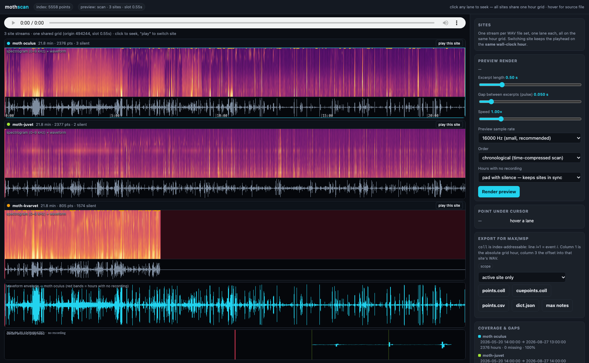

# mothscan

**Time-compress months of AudioMoth field recordings into something you can actually listen to.**

`mothscan` scans an audio deployment, picks the acoustically most interesting
moment in every hourly recording, stitches those moments into per-site preview
streams, lets you browse them as waveform + spectrogram in a browser, and exports
the cue points for Max/MSP.

Built for a real 99-day, three-site, 64 GB deployment (5,558 files), but written
so it is configurable for any AudioMoth-style hourly recorder.



*Three sites as aligned lanes on one shared hour grid. Click any lane to seek;
hover to resolve a moment back to its source file and absolute UTC hour.*

---

## What it does

| | |
|---|---|
| **Finds events** | A hybrid, self-normalising score over four complementary window statistics — spectral novelty, envelope transient, contrast against local background, and spectral flatness |
| **Rejects contamination** | Wind noise and microphone clipping detected from their physical signatures, penalised per-window, and whole hours substituted from a neighbour when unusable |
| **Keeps sites in sync** | One shared hourly grid: slot *i* sits at an identical stream offset in every site, so the same wall-clock hour can be compared across locations |
| **Renders previews** | One WAV per site; excerpt length, gap (or *overlap*), crossfade, limiter and speed all adjustable at render time |
| **Browser viewer** | Spectrogram lanes, waveform, playback, click-to-seek, per-site export |
| **Exports for Max** | Per-site `coll` files, index-addressable, with a grid column for absolute scheduling |

Measured on the reference deployment: **5,558 files (64 GB) analysed in ~240 s**
on 15 cores, then rendered into three aligned streams.

---

## Quick start

```bash
git clone https://github.com/materialvision/mothscan.git
cd mothscan
./mothscan.sh setup                      # venv + dependencies + an import check

# point it at your recordings
export MOTHSCAN_SITE_ROOT=/path/to/your/deployment   # default: /Volumes/Solardisk/Harpefoss
export MOTHSCAN_SITES="site-a,site-b,site-c"         # default: the Harpefoss site names

./mothscan.sh scan --limit 200           # try 200 files first
./mothscan.sh stats                      # coverage and gate rates
./mothscan.sh preview                    # render the per-site streams
./mothscan.sh start                      # viewer in the background
./mothscan.sh open                       # ...or start it and open a browser
```

The viewer has a proper lifecycle, so you are never guessing whether it is up:

```bash
./mothscan.sh status     # exit 0 = running, 1 = not (scriptable)
./mothscan.sh logs       # tail data/viewer.log
./mothscan.sh restart
./mothscan.sh stop
./mothscan.sh serve      # foreground instead, ctrl-c to stop
```

`start` is idempotent — it will not run a second server on the same port — and it
does not report success until the API actually answers. Other commands:
`build` (scan → preview → export), `test` (unit tests, no data needed), and
`verify` (34 headless behavioural checks against the viewer).

**Environment variables** (all optional):

| variable | default | purpose |
|---|---|---|
| `MOTHSCAN_SITE_ROOT` | `/Volumes/Solardisk/Harpefoss` | directory holding one sub-directory per site |
| `MOTHSCAN_SITES` | the three Harpefoss names | comma-separated site directory names |
| `MOTHSCAN_DATA_DIR` | `<repo>/data` | where caches, indexes and renders go (can be large) |
| `MOTHSCAN_PROJECT_DIR` | repo root | base for the above |

---

## How the analysis works

Each 2-minute recording is scored for *the most interesting 0.5 s*, using four
window statistics that cover each other's blind spots:

| term | window statistic | finds |
|---|---|---|
| `novelty` | mean spectral flux, with a per-mel-band noise floor subtracted | birdsong, insect stridulation, rain onsets |
| `transient` | peak envelope attack | raindrops, clicks, wing claps |
| `contrast` | loudest envelope vs. its own local background | events that stand out |
| `flatness` | spectral flatness | broadband events a flux detector misses |

Two details do most of the work:

* **Per-band noise-floor subtraction** in the novelty curve, so stationary
  rain/wind contribute ≈0 and the same detector works in a silent forest night
  and a downpour.
* **Windowed, not per-frame normalisation.** A 120 s file is mostly empty frames,
  so a per-frame percentile sits in the noise and every ratio explodes. A term of
  1.0 instead means "as eventful as the busiest part of this hour", which makes a
  3 a.m. hour comparable to a noon chorus.

Placement uses an **absolute pre-roll** (`max(10 ms, 10 % of excerpt)`) rather
than a fraction of the analysis window, so changing the excerpt length never
loses the event — a fraction of the window is a fixed number of milliseconds and
silently dropped the event below ~0.18 s.

Full detail, including the noise classifier and the measured evidence behind
every threshold, is in **[mothscan/README.md](mothscan/README.md)**.

---

## Overlap, speed and levelling

**Negative gap overlaps the excerpts.** The number sounding at once is
`cut ÷ slot pitch`:

| gap (cut 0.5 s) | slot pitch | clips overlapping |
|---|---|---|
| +0.05 | 0.550 s | 1 |
| −0.25 | 0.250 s | 2 |
| −0.375 | 0.125 s | 4 |
| −0.40 | 0.100 s | 5 |

The slot pitch must stay positive — it is what keeps the sites aligned — so a
pitch of zero is refused rather than rendered. Overlap also shortens the stream
(99 days goes from 21.8 to 9.9 min per site at `gap = −0.25`).

**The limiter** pushes peaks down without ever lifting quiet material, so a
passing train cannot bury the birds while every event keeps its level relative to
every other. Measured on one train file: peak −0.00 → −12.00 dBFS, quietest
moment untouched, dynamic range 35.6 → 23.6 dB.

**Speed** compresses the whole stream, slot pitch included, and never touches the
grid index — so alignment survives. For *listening* at speed, the viewer's
`play at` control uses the browser's own pitch-preserving time stretch, which is
better than anything rendered offline and needs no re-render.

---

## Layout

```
mothscan/
  mothscan/
    config.py        dataset layout + AnalysisConfig / PreviewConfig
    features.py      STFT, mel, novelty curve, envelopes, flatness, noise indicators
    scoring.py       the hybrid score, event-centred placement, 2-pass search
    noise.py         wind / clipping detection, penalties, substitution policy
    select.py        final point choice incl. nearby-hour substitution
    timeline.py      the shared hourly grid, slot mapping, missing-data policy
    pipeline.py      discovery, parallel analysis, resumable runs, retune
    index_store.py   SQLite + JSONL index, versioned feature cache
    preview.py       per-site stream renderer, limiter, time-stretch, browser assets
    export.py        per-site coll / cuepoints / csv / dict / Max notes
    webapp.py        FastAPI: multi-site viewer, metadata, render, export
    cli.py           scan / retune / stats / inspect / pick / preview / export / serve
  web/static/index.html    the whole viewer (no build step, no plotting dependency)
  scripts/
    diagnose.py            spectrogram + score-curve + waveform figures
    characterise_noise.py  measure wind/clipping indicators over a sample
    calibrate_noise.py     indicator distributions + flagged populations
    validate_noise.py      labelled galleries to check thresholds by eye
    bench.py               per-file timing and score breakdown
    verify_ui.mjs          headless behavioural test of the viewer
    shoot.mjs              deterministic screenshot
  tests/test_preview.py    unit tests: speed, pitch, limiter, overlap, crossfade
  mothscan.sh              entry point: setup / start / stop / status / logs / build
```

---

## Tests

```bash
.venv/bin/python tests/test_preview.py   # 21 unit tests, no data needed
./mothscan.sh verify                     # 34 browser checks against a live viewer
```

The unit tests cover the things that were genuinely subtle: speed direction and
pitch, the limiter's ceiling and zero latency, overlap summing, crossfade
flatness, and that exported stream offsets match the render.

---

## Data and privacy

No audio is included — the deployment is 64 GB and belongs to the field site.
Generated artifacts (caches, indexes, preview WAVs) are git-ignored; only the
viewer screenshot is committed.

---

## License

MIT — see [LICENSE](LICENSE).

Developed by Espen Sommer Eide. The reference deployment is an AudioMoth
"Basic"-firmware recording series (48 kHz / 16-bit mono, 120 s every hour).
